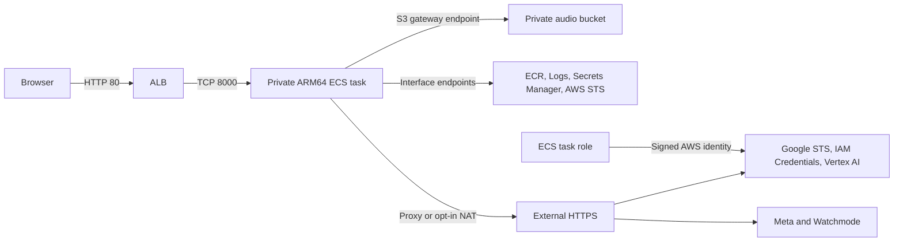

# Deployment architecture and preflight

The public ALB accepts HTTP on port 80 and forwards requests to port 8000 on ECS
tasks in private subnets. RDS, S3, ECR, Secrets Manager and CloudWatch remain
separate. ECS has an execution role for image pulls, logs and configured
secrets, and a task role for S3 audio and the outbound Google identity.
RDS is provisioned by CDK and configured in ECS. The backend has no database
client or query path, so provisioning alone does not make RDS an application dependency.



## Network choices

| Mode | Cost and operations | Security and test fit |
| --- | --- | --- |
| Default `none` | No new egress cost | S3 and AWS endpoints only. Offline health checks work. External APIs remain unreachable. |
| `proxy` | Reuse a reachable proxy if available. A new proxy adds compute, monitoring and maintenance. | Keep private tasks and use HTTPS CONNECT with a destination allowlist. Best low-cost test option if a managed or existing proxy is available. |
| `nat` | A single managed NAT in public subnet A incurs hourly and data-processing charges plus public IPv4 charges. Cross-AZ flows can add charges. | Simple temporary development setup. Both private subnets share a route table, so both depend on this NAT and AZ. Review egress controls and per-AZ redundancy for production. |
| NAT instance | EC2, public IPv4 and traffic charges. Requires OS patching, forwarding, monitoring and failover. | Can be economical for light use, but adds operational work. No NAT instance is provisioned by this code. |
| Cross-cloud private path | Connectivity plus routing and DNS operations on both clouds. | Google Private Service Connect for Google APIs can be reached over a supported hybrid path such as Cloud VPN or Interconnect. It is not supplied by AWS service endpoints and does not cover Meta or Watchmode. |

Set `-c networkEgress=proxy -c backendHttpsProxy=http://PROXY_HOST:PORT` to inject
proxy settings for an existing service. Restrict its ingress to the ECS
security group, allow only required HTTPS destinations, and use TLS
passthrough. At minimum allow Google STS, IAM Credentials and the configured
Vertex endpoint, typically `aiplatform.googleapis.com` for global, plus any
enabled Meta and Watchmode hosts. Validate the SDKs from a real task.
AWS SDK endpoints and ECS credential metadata bypass the proxy. The proxy
itself is external to this CDK app.

With approval, `-c networkEgress=nat` generates the NAT, EIP and default private
route. The specific S3 endpoint route remains in place. Default synthesis
creates none of those resources. See [AWS NAT pricing](https://aws.amazon.com/vpc/pricing/),
[AWS NAT instances](https://docs.aws.amazon.com/vpc/latest/userguide/VPC_NAT_Instance.html),
and [Google private endpoints for hybrid networks](https://cloud.google.com/vpc/docs/configure-private-service-connect-apis-hybrid).

## Google Workload Identity Federation setup

Ask a Google administrator with the appropriate project and service-account
IAM permissions to enable APIs, create and manage pools and providers, and
grant the bindings shown below. Workload Identity Pool Admin
(`roles/iam.workloadIdentityPoolAdmin`) covers pool and provider management.
Service Usage Admin, Service Account Admin, and a project IAM administrator
can perform the other corresponding operations. The runtime service account
receives Vertex AI User (`roles/aiplatform.user`). Its only federated member
should be the exact ApnaSathi task role using `roles/iam.workloadIdentityUser`.

Obtain the role ARN from the CDK output `BackendTaskRoleArn` after an approved
infrastructure rollout, or from the existing service's task definition. Use
the IAM role name from the ARN in `TASK_ROLE_NAME`. Use the task role identified
by `taskRoleArn`. The execution role is used only by ECS to inject the
federation configuration and other secrets.

Run in Windows CMD as an authorized Google administrator. Replace the
placeholders with your own Google configuration and the actual AWS task role.

```cmd
set "GCP_PROJECT=YOUR_GOOGLE_PROJECT_ID"
set "GCP_PROJECT_NUMBER=YOUR_GOOGLE_PROJECT_NUMBER"
set "WIF_POOL=YOUR_WORKLOAD_IDENTITY_POOL_ID"
set "WIF_PROVIDER=YOUR_AWS_PROVIDER_ID"
set "GCP_SERVICE_ACCOUNT_ID=YOUR_GOOGLE_SERVICE_ACCOUNT_ID"
set "SERVICE_ACCOUNT=%GCP_SERVICE_ACCOUNT_ID%@%GCP_PROJECT%.iam.gserviceaccount.com"
set "AWS_ACCOUNT=553607360155"
set "TASK_ROLE_NAME=YOUR_ECS_TASK_ROLE_NAME"
gcloud services enable iam.googleapis.com sts.googleapis.com iamcredentials.googleapis.com aiplatform.googleapis.com --project="%GCP_PROJECT%"
gcloud iam service-accounts create "%GCP_SERVICE_ACCOUNT_ID%" --project="%GCP_PROJECT%"
gcloud projects add-iam-policy-binding "%GCP_PROJECT%" --member="serviceAccount:%SERVICE_ACCOUNT%" --role="roles/aiplatform.user"
gcloud iam workload-identity-pools create "%WIF_POOL%" --project="%GCP_PROJECT%" --location=global
gcloud iam workload-identity-pools providers create-aws "%WIF_PROVIDER%" --project="%GCP_PROJECT%" --location=global --workload-identity-pool="%WIF_POOL%" --account-id="%AWS_ACCOUNT%" --attribute-mapping="google.subject=assertion.arn,attribute.aws_role=assertion.arn.extract('assumed-role/{role_name}/')" --attribute-condition="attribute.aws_role=='%TASK_ROLE_NAME%'"
gcloud iam service-accounts add-iam-policy-binding "%SERVICE_ACCOUNT%" --project="%GCP_PROJECT%" --role="roles/iam.workloadIdentityUser" --member="principalSet://iam.googleapis.com/projects/%GCP_PROJECT_NUMBER%/locations/global/workloadIdentityPools/%WIF_POOL%/attribute.aws_role/%TASK_ROLE_NAME%"
gcloud iam workload-identity-pools create-cred-config "projects/%GCP_PROJECT_NUMBER%/locations/global/workloadIdentityPools/%WIF_POOL%/providers/%WIF_PROVIDER%" --service-account="%SERVICE_ACCOUNT%" --aws --output-file="%TEMP%\apnasathi-vertex-wif.json"
```

Use the generated external-account JSON verbatim in an AWS Secrets Manager
secret in `ap-south-1`. This file contains federation configuration and no
service-account key. Keep it outside the repository and image. If using a
customer-managed KMS key, separately authorize the ECS execution role to
decrypt that key. The code validates the Google endpoints, ignores the
generated EC2 metadata credential source, and signs using temporary
credentials retrieved through boto3's ECS container-role provider.

The following AWS command creates a secret. Run it only after cloud-change approval.

```cmd
aws --profile apnasathi --region ap-south-1 secretsmanager create-secret --name apnasathi/vertex-wif --secret-string "file://%TEMP%\apnasathi-vertex-wif.json" --query ARN --output text
```

Pass the complete ARN through `googleWifSecretArn` and provide
`googleCloudProject` and optionally `googleCloudLocation`. Defaults use
the global Vertex endpoint and zero desired tasks. This is an offline synthesis example using the repository's uv environment.
The HTTP listener requires no ACM certificate or certificate context.

```cmd
cd aws_cloud
npx --yes aws-cdk@2.1149.0 synth --no-lookups --app "..\.venv\Scripts\python.exe -B app.py"
```

For local development, use `gcloud auth application-default login`, set
`GOOGLE_CLOUD_PROJECT` and `GOOGLE_CLOUD_LOCATION`, then run the backend normally.
Clear `GOOGLE_WIF_CONFIG_JSON` in local development. No permanent Google
service-account key is needed.
[Google AWS federation setup](https://docs.cloud.google.com/iam/docs/workload-identity-federation-with-other-clouds) ·
[Python credential supplier](https://google-auth.readthedocs.io/en/latest/reference/google.auth.aws.html)

## ECS and manual deployment checks

- The backend still runs Linux ARM64, port 8000, 512 CPU units and 1024 MiB.
  Measure Whisper startup and peak memory on ARM64 before increasing traffic.
- ALB and container health check `/api/v1/health`. This tests application
  liveness without requiring Vertex or S3. The container gets 120 seconds to
  start, and ECS permits 45 seconds to stop while Uvicorn drains for up to 35.
- The circuit breaker rolls back failed deployments. Private subnets, task
  and execution roles, and CloudWatch logging remain in place.
- Before publishing anything, confirm the Mumbai account identity and service quotas:
  `aws sts get-caller-identity --profile apnasathi --region ap-south-1`.
  An approved infrastructure rollout must create the service and ECR first,
  with desired count zero. Set its immutable SHA tag and count one only
  after an image exists and external access has been validated.
- Run **Deploy ApnaSathi Infrastructure** and **Deploy ApnaSathi Application**
  separately from GitHub Actions on `main`. Both call the reusable bootstrap
  workflow first. It queries `CDKToolkit` with `INFRASTRUCTURE_ROLE_ARN` and skips
  bootstrap for an already-bootstrapped environment. If the stack is missing,
  it requires a distinct, authorized `BOOTSTRAP_ROLE_ARN`. The backend job
  uses only `AWS_ROLE_ARN` for its deployment operations.
- Infrastructure deploys all four stacks in dependency order. Set
  `BACKEND_IMAGE_TAG=v1` and `BACKEND_DESIRED_COUNT=0` initially. Add
  `GOOGLE_CLOUD_PROJECT`, `GOOGLE_WIF_SECRET_ARN` and optionally
  `GOOGLE_CLOUD_LOCATION` once federation is configured. Select egress through
  `NETWORK_EGRESS`, using `BACKEND_HTTPS_PROXY` for proxy mode. After each
  successful application rollout, reconcile the CDK image tag and desired
  count before the next infrastructure deployment.
- Application checks the service's current task definition, builds and
  smoke-tests the ARM64 image, pushes its immutable commit-SHA tag, and
  verifies ECS stabilized on the expected revision. Verify live policy v2
  includes the repository-scoped ECR push permissions in the checked-in policy,
  including `ecr:BatchGetImage`. An immutable tag rejects re-pushing the same SHA.
  [AWS ECR push permissions](https://docs.aws.amazon.com/AmazonECR/latest/userguide/image-push-iam.html).
- Before public traffic, require verified user authentication and rate
  limiting. Test Vertex with a short non-sensitive prompt, S3 with a test
  recording, and Instagram with a professional test account after approval.

## Windows CMD validation

From the repository root:

```cmd
uv lock --check
.venv\Scripts\python.exe -B -m unittest discover -s backend/tests -v
.venv\Scripts\python.exe -B -m unittest discover -s aws_cloud/tests -v
actionlint .github\workflows\deploy.yaml .github\workflows\deploy-infrastructure.yaml .github\workflows\bootstrap.yaml
docker buildx build --platform linux/arm64 --load -t apnasathi-backend:local .
docker image inspect apnasathi-backend:local --format "{{.Os}}/{{.Architecture}}"
docker run --rm --name apnasathi-local --platform linux/arm64 -p 127.0.0.1:8000:8000 apnasathi-backend:local
```

In a second terminal run `curl.exe --fail http://127.0.0.1:8000/api/v1/health`.
No image push or AWS modification occurs during these checks.

The HTTP ALB is suitable for development health checks. Browser microphone
capture on a public origin and the existing Instagram callback need HTTPS.
S3 transport and outbound calls to Google and Meta still use HTTPS.

## Hosted frontend and sign-in

Build the hosted frontend with `VITE_API_BASE_URL=/api/v1` and the public Cognito region, user pool ID and app client ID for the target environment. Set the build variables explicitly so the developer's ignored `.env.local` cannot select localhost for the hosted build.

Serve the built assets over HTTPS. On the same hostname, route `/api/v1/*` to the backend and serve `index.html` for client routes such as `/record`. Keep the backend API path prefix intact. The development ALB currently accepts HTTP, so terminate TLS at the hosting edge before forwarding to the ALB.

Set the GitHub environment variables `COGNITO_USER_POOL_ID` and `COGNITO_CLIENT_ID` to the same public identifiers used in the frontend. The infrastructure workflow forwards them into the ECS container. The public client needs SRP and permission to write the `name` attribute at signup. The running task needs network access to the Cognito JWKS endpoint.

Before enabling browser traffic, run `python -m alembic -c backend/alembic.ini upgrade head` from the repository root in a controlled migration runner with the intended RDS connection, private-subnet connectivity and permission to create the vector extension. Then verify HTTPS health, signup and email confirmation, sign-in, profile creation, and chat persistence with a development account.
